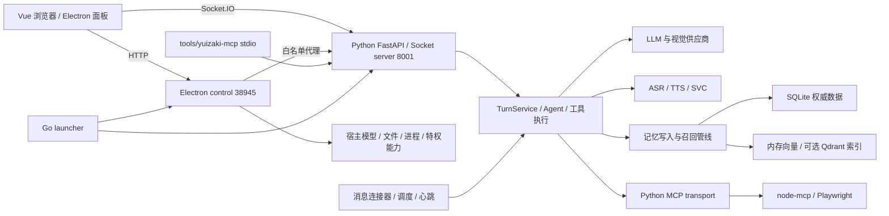

# Yuizaki 工作区全链路审计

## 审计边界与证据

本报告按启动批次命名为 2026-11-09。证据采集跨越北京时间午夜，精确采集时间见 audit-evidence-2026-11-09/environment.json 的 UTC 时间；不以文件名推断运行时刻。

目标：梳理所有相关后端边界、实际公开功能链路、函数调用与长期记忆机制，检查浏览器面板，并对实际功能给出可验收的改进。此次交付为审计报告和复现材料，未实施业务修复。

基线：Git main，HEAD `865df8a284a3c7ea29a5c50f1c689d2c955e8680`。开始时已有 10 个前端源码修改，未覆盖或撤销。源码、运行实例、构建产物分开取证：

- 工作树用于代码审计、类型/lint/单测和静态调用清单。
- 运行实例为 Python 8001、Vite 5173、control 38945。实际完整面板巡检使用 control 的浏览器构建产物。
- 构建 index.html 时间为 23:52:17，ChatRuntimeSettings.vue 时间为 23:53:17；至少该源码晚于构建。因此浏览器巡检不能替代当前源码的构建与功能验证。未重新构建覆盖现有服务。
- 全局 Python 的 FastAPI 为 0.128.0，项目 `.venv` 为 0.143.2；关键契约已在项目解释器复测。环境差异是路由 manifest 缺陷的重要条件。

**证据类别：**运行/隔离复现＝实际观察或合成数据重现；源码确证＝控制流明确存在但未执行真实用户操作；推断＝由控制流推出可能影响；未知＝现有证据不能定责。没有把所有代码路径称作端到端通过。

## 阅读入口

- [后端链路与问题](audit-2026-11-09-backend.md)
- [长期记忆专项](audit-2026-11-09-memory.md)
- [全部前端面板和设置子页改进矩阵](audit-2026-11-09-frontend.md)
- [测试结果、TTS/manifest 复现与授权边界](audit-2026-11-09-verification.md)
- [证据与复现索引](audit-evidence-2026-11-09/README.md)

## 系统边界

这个图表示边界与主要调用方向，不表示所有请求都经过同一个入口。浏览器 Socket 事件与 HTTP 代理是两条路径；tools/yuizaki-mcp 与 node-mcp 是用途不同的两个服务。

## 静态函数取证覆盖

除逐链路人工审查，已生成机器可检索清单：

| 清单 | 扫描结果 | 能证明什么 |
|---|---|---|
| Python AST | 224 文件、3409 函数、29221 调用点、205 个路由/事件装饰器；解析错误 0 | 函数定义、行号、文本调用目标、imports、静态装饰器位置。 |
| TypeScript/Vue/JS | 276 文件、6316 个函数/回调、22847 调用点 | Electron main/renderer、两个 Node MCP 的函数/回调和 import 边界。 |

清单排除依赖、测试、生成包和数据目录。调用点是语法事实，未将动态派发、反射、IPC、回调和文本 target 假装为已解析的运行调用图。Go launcher 另核对入口契约；没有把纯语法统计等同于每个函数已执行。

## 当前需要优先处理的结论

| 优先级 | 结论 | 证据类别与影响 |
|---|---|---|
| P1 | candidate 永久删除后仍保留正文并可从 all-state 导出 | 记忆合成数据复现；删除契约不成立，见 M-01。 |
| P1 | 首次建索引后部分 metadata-only 新记忆不可召回 | 合成复现，重建后才可召回；不是所有写入路径都受影响，见 M-02。 |
| P1 | embedding 失败时数据库已写入、进程列表尚未更新 | 合成复现；调用报错与权威持久化分裂，见 M-03。 |
| P1 | HTTP stream=true 首包等待最终reply；TTS取消A会取消并发B | HTTP控制流静态确证、TTS异步任务隔离复现，见B-02/B-05。 |
| P1 | TTS 流完成事件调用缺失方法 | 使用当前真实 adapter 与 bridge 在内存复现 TypeError；可能影响最终 busy 清理，见 V-01。 |
| P1 | 备份恢复未绑定预览目标；刷新竞态可让旧结果覆盖新状态；离线取消仍提示已请求 | 源码确证的条件性缺陷，尚未执行真实恢复/取消副作用，见 F01–F03。 |
| P1 运行异常 | 两次 /health 观察均超过 8 秒；一次 /api/workspaces 504 | 已观测可用性异常，未定位阻塞函数；不把它直接归因于 LLM/DB/记忆，也不把它等同 onboarding 的 /api/ping 失败。 |
| P2 | route manifest 漏掉 include_router | 项目 venv 合成与运行复现；运行仅列 4 路由。现有三例清单测试未覆盖实际注册方式。 |
| P2 | memory scope 更新能写出无 session 的孤立记录；关系扩展突破 limit | 记忆合成复现，见 M-04/M-05。 |
| P2 | 引导显示旧失败/隐藏具体错误；390px 聊天控件位于视区外 | snapshot/DOM 实证与源码对应；见前端报告。 |
| P2 | 英文六键缺失、设置无效初值 | 三个 i18n 测试失败、lint 失败；与 TTS 类型错误共同阻断现有质量检查。 |

## 浏览器与健康观测的解释

完整 14 路由巡检未出现 pageerror；26 次主要子页签切换轮次未捕获 HTTP 错误。启动轮次则捕获 /api/workspaces 504 与自动 PATCH 的 409，应保留异常证据，不能将总体结果描述成“前端全部正常”。409 是已实现的 revision 冲突保护，尚无数据丢失证据。

三种健康语义必须区别：control `/api/health` 固定返回 ok，只证明控制服务存活；Python `/api/ping` 轻量存活并提供 runtime 身份；Python `/health` 并发检查依赖且包含外部供应商探测。onboarding 调用的是 pythonService.health→`/api/ping`，还需身份或 challenge proof。不能用普通 ping 200 覆盖 readiness 失败，也不能把 /health 延迟直接当成该失败根因。

普通本机 API 当前明确采取 loopback 信任模型，Python 与 control 均有本机豁免；这是实际产品授权边界。未将其泛称成已证远程漏洞，也未误报默认本机 MCP 因不带 token 必然失败。专用宿主 token、vault 与 perception 边界需独立评估。

## 修复实施顺序与验收门槛

1. **先修数据与完成契约。** M-01 清理正文和含原文 metadata；M-02/M-03 统一权威写入和索引恢复状态；V-01 接齐现有 TTS 完成委托。验收必须用已保存探针反向证明缺陷不再存在，而不只看接口 200。
2. **再修高影响操作。** 备份预览冻结目标；取消任务等待发送/ACK/终态；列表和编辑器按 workspace/entity/request 代次提交。使用逆序响应、断线、部分失败测试，避免真实用户数据恢复/删除。
3. **对齐运行契约。** 修 route manifest、health/readiness 分层、引导快照新鲜度、scope 约束和关系预算。项目 venv 与当前构建必须成为验证环境。
4. **逐面板完成恢复和可用性。** 按前端矩阵补保存确认、dirty 草稿、批处理逐项结果、能力门控、真实附件 payload、窄屏控件；清除 i18n、lint 和类型门禁。只为明确触发行为增加回归测试，避免创建泛化抽象。

项目 venv 的两组现有 Python 测试共 **179 passed（101+78）**；另有五个记忆缺陷探针、六个后端动态场景、TTS前端桥接和路由manifest复现。测试通过与缺陷复现同时成立，反映既有测试未覆盖这些触发条件。

各项具体文件、触发步骤和验收均见专项文档。此顺序是审计建议，没有自动实施修复或部署。

## 明确的验证空白

- 未调用真实 LLM 对话/收费推理，也未发送连接器消息；真实多轮工具/流媒体投递需要单独验收环境。
- 未进行真实麦克风/扬声器/ASR/TTS 声学测试；TTS 完成异常为内存事件复现。
- 未恢复生产备份、永久删除真实记忆或遍历真实私人记忆正文；数据探针使用临时存储与合成数据。
- 未启用 Qdrant、Docker、QQ扫码等可选外部服务进行整链验收；不能将默认关闭当功能故障。
- Go 测试受本机 1.26.2 与项目要求 ≥1.27 不符阻断；不下载工具链改变环境。
- /health 的具体慢函数尚未定位；须在同一时段记录各 provider 耗时、事件循环延迟和取消收尾，而不是猜测。
- 静态调用清单覆盖已扫描源文件，不代表动态插件、外部 MCP 或 native SDK 内部实现已穷尽。
